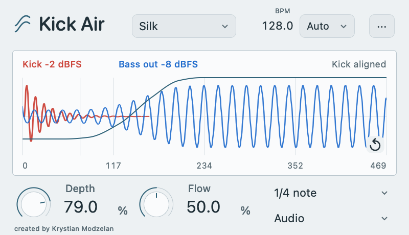

# Kick Air

Free sidechain ducking for Windows and macOS.

Kick Air turns down your bass when the kick hits, with both waveforms on the same
view so you can see when the bass comes back in. It also works with a snare or
another sound sent to the external sidechain.

## Download the beta

| Platform | Format | Installer |
| --- | --- | --- |
| Windows 10/11, 64-bit | VST3 | [Download EXE](https://github.com/kikk-i/kick-air/releases/download/v0.3.2-beta.1/KickAir-0.3.2-Windows-x64.exe) |
| macOS 11+, Apple Silicon and Intel | AU and VST3 | [Download PKG](https://github.com/kikk-i/kick-air/releases/download/v0.3.2-beta.1/KickAir-0.3.2-macOS.pkg) |

Version 0.3.2 beta. No account, activation or time limit.

This update replaces all 16 factory curves and shows preset names without
thumbnail graphics on both platforms. Custom curve points are unchanged. Factory
preset selections in older projects may sound different after updating.

Save your project and close your DAW before installing. Restart it afterwards and
rescan plugins if needed. These are unsigned beta installers. The macOS package
is not notarized. Installation details and the standard macOS approval process
are in the [user guide](USER_GUIDE.md).

## Quick start

1. Put Kick Air on the bass or other track you want to duck.
2. Route the kick to its external sidechain input. Keep the kick's normal output
   going to the master.
3. Leave Audio selected. Set Depth for the amount of ducking and Flow for the
   character of the return.

In FL Studio, create **Sidechain to this track** first, then assign the kick input
in the wrapper's **Processing / Connections** panel. A normal audio send would
mix the kick into the bass track. [Full routing instructions](USER_GUIDE.md#fl-studio-routing).

## Controls

- Depth and Flow, with exact values and editable curves.
- Red kick and blue processed bass on one captured timeline.
- Audio triggering from real hits, including irregular rhythms.
- Project BPM sync or manual tempo.
- 1/8, 1/4, 1/2 and one-bar response lengths.
- Curve dragging, point editing and optional low-band ducking.

## Help test it

Please report your DAW, OS, plugin format, sample rate and buffer size. Routing,
clicks, project recall, offline export and display scaling are useful things to
check. [Testing checklist](TESTING.md) and [bug reports](https://github.com/kikk-i/kick-air/issues/new/choose).

See the [validation summary](VALIDATION.md) for checks on this build. This update
was not manually retested in DAWs. Testing on physical Windows PCs is still
needed. Compatibility with every DAW is not confirmed.

This repository contains downloads and documentation. Plugin source code is not
included. The screenshot uses generated test audio.

## Support

If you would like to support development, you can [buy me a coffee](https://buycoffee.to/kikk-i).
Support is optional.

created by Krystian Modzelan
